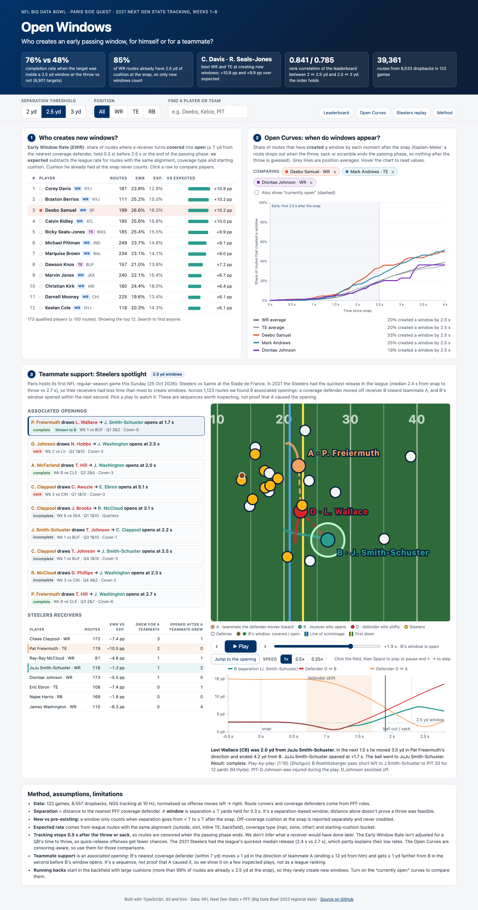

# Open Windows: who creates an early passing window, for himself or for a teammate?

**Open Windows** is an interactive tool that measures how often a WR, TE or RB turns a *covered* route into an *open* one (≥ 2.5 yd from the nearest coverage defender, held 0.3 s) within 2.5 s of the snap, compared with the league rate for routes with the same alignment, coverage type and starting cushion. Windows matter: passes to a target inside one at release were completed **76%** of the time vs **48%** when he wasn't (6,901 targets), and since **85%** of WR routes already start with that cushion, only *new* windows are credited. Corey Davis, Braxton Berrios, Deebo Samuel and Calvin Ridley lead the receivers (+10 pp over expected) and Ricky Seals-Jones leads the tight ends; a Steelers spotlight, ahead of Sunday's Paris game vs the Saints, replays 9 plays where a defender left one receiver for a teammate and the first receiver opened within a second. Coaches can use it to pick quick-game reads and route combinations, scouts to compare receivers, and broadcasters to tell the story of a play. Limits: separation is distance to the nearest PFF coverage defender, not proof a throw was possible; tracking stops at the throw, so the rate favours offenses that hold the ball longer (the 2021 Steelers had the league's quickest median release, 2.4 s vs 2.7 s); and the teammate plays show a sequence, not causation.

**How to run:** `npm install && npm run dev` (Node ≥ 23.6). The computed data is committed in `public/data/`. To recompute it from raw tracking, clone [the dataset](https://github.com/ThompsonJamesBliss/nfl-big-data-bowl-regional-event-data) into `./nfl-big-data-bowl-regional-event-data` and run `npm run pipeline` (about 8 s for 8.3 M tracking rows).

## What's on the page

1. **Early Window Rate over expected**: a leaderboard filterable by threshold (2 / 2.5 / 3 yd), position, name or team code. Click rows to compare up to 3 players.
2. **Open Curves**: a Kaplan–Meier curve of the share of routes that have *created* a window by time t (censored when the throw, sack or scramble ends the passing phase), against the position average. A toggle adds the share *currently* open.
3. **Steelers spotlight**: a synced replay of each associated opening, with completed passes to B listed first. It has a field view with trails, B's separation ring and a legend, a distance chart showing the defender's shift, and step, jump-to-opening, speed and keyboard controls.

## Method notes

- **Data:** 122 games (2021, weeks 1–8), 8,533 analysed dropbacks, 39,361 routes, NGS tracking at 10 Hz normalised so offense moves left → right. PFF roles identify route runners and coverage defenders. Targets are parsed from the play-by-play text (6,917 matched).
- **Window:** separation goes from below T to at least T after the snap and holds for 3 frames. Cushion a receiver already had at the snap is reported separately (`openAtSnapShare`) and never credited.
- **Expected rate:** league rate per alignment (outside / slot / inline TE / backfield) × coverage (man / zone / other) × starting-cushion bucket.
- **Robustness:** the player ranking holds across thresholds (Spearman ρ = 0.84 for 2 vs 2.5 yd, 0.79 for 2.5 vs 3 yd). 173 players have ≥ 100 routes.
- **Associated opening:** B's nearest coverage defender (≤ 7 yd) moves ≥ 1 yd in A's direction (ending ≤ 12 yd from A) and gets ≥ 1 yd farther from B in the 1 s before B's window opens. It's deliberately limited to one team's inspected plays, not a league-wide ranking.
- **Running backs** start in the backfield with large cushions (more than 99% of routes are ≥ 2.5 yd at the snap), so they rarely *create* windows. Their dashed "currently open" curve is the useful view.

## Code

| Path | Role |
|---|---|
| `pipeline/` | Node + TypeScript (run natively, no build step): CSV loading, coordinate normalisation, separation, windows, Kaplan–Meier curves, expected rates, associated openings → `public/data/*.json` |
| `shared/types.ts` | Typed JSON contract shared by the pipeline and the web app |
| `src/` | Vite + TypeScript + d3 front end: leaderboard, curves, replay |

Built during the NFL Big Data Bowl Paris Side Quest (21 Oct 2026) with Kiro. Data: NFL Next Gen Stats and PFF.
